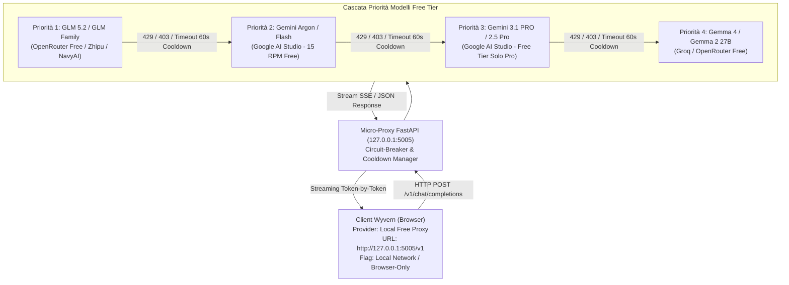

# Wyvern AI Proxy Rotator

Questa skill codifica e standardizza l'architettura e le procedure operative per la configurazione, l'esecuzione e la manutenzione del **Micro-Proxy di Failover Locale per Wyvern** (`scripts/free_tier_proxy.py`). Il proxy espone un'interfaccia standard OpenAI-compatible a latenza zero che risolve i blocchi di rate-limit (`HTTP 429`) e di pausa temporanea del Free Tier (`HTTP 403`), instradando le richieste su una cascata gerarchica di modelli gratuiti.

---

## 1. Architettura di Routing e Cascata di Priorità



---

## 2. Componenti Software di Progetto

1. **Proxy Server (`scripts/free_tier_proxy.py`):**
   * Realizzato in FastAPI / Uvicorn con `CORSMiddleware` aperto (`*`).
   * Endpoint OpenAI: `/v1/chat/completions` (streaming SSE e JSON) e `/v1/models` (scoperta modelli per UI Wyvern).
   * Endpoint diagnostico: `/health` per monitorare lo stato operativo e i timer di quarantena di ciascun upstream.
2. **Configurazione Hot-Reload (`scripts/config_free_proxy.json`):**
   * Ricaricamento dinamico tramite verifica del timestamp `mtime`: qualsiasi chiave o parametro modificato viene applicato all'istante senza arrestare il server.

---

## 3. Parametri di Configurazione Wyvern UI

Quando si registra il proxy locale nell'interfaccia di Wyvern (`AI Connections`):

### Scheda Providers (`+ Create Provider`)
* **Name:** `Local Free Proxy`
* **API URL:** `http://127.0.0.1:5005/v1`
* **API URL Type / API Backend Type:** `OPENAI` / `OPENAI`
* **Local Network / Browser-Only:** **`ON` (Obbligatorio)**. Instrada le chiamate direttamente dal browser locale al server `127.0.0.1`, bypassando i server cloud di Wyvern.
* **No API Key Required:** **`ON`** (oppure inserire un token fittizio `sk-local`).
* **Chat Completion Only:** **`ON`**.

### Scheda Connections (`+ New Connection`)
* **Connection Name:** `Free-Tier-Master`
* **Selected Provider:** `Local Free Proxy`
* **Model ID:** `free-tier-master` (oppure cliccare *Fetch Models*).
* **Context Window (`max_tokens` top-level):** `1.000.000` (finestra di memoria massima supportata da GLM e Gemini).
* **Max Generation Tokens (`parameters.max_tokens`):** **`4.096` (Obbligatorio)**. Non inserire la dimensione del contesto in questo campo per evitare errori di schema o budget di generazione ecceduto.
* **Temperature:** `0.75` | **Top P:** `0.95`.

---

## 4. Comandi Operativi di Gestione

### Avvio del Proxy in Background (PowerShell)
```powershell
python scripts/free_tier_proxy.py
```

### Verifica Stato e Cooldown Upstream
```powershell
python -c "import urllib.request, json; print(json.loads(urllib.request.urlopen('http://127.0.0.1:5005/health').read()))"
```

### Test Chiamata di Completamento
```powershell
python -c "import urllib.request, json; req = urllib.request.Request('http://127.0.0.1:5005/v1/chat/completions', headers={'Content-Type': 'application/json'}, data=json.dumps({'model': 'free-tier-master', 'messages': [{'role': 'user', 'content': 'Ping'}], 'max_tokens': 10}).encode('utf-8')); print(urllib.request.urlopen(req).read().decode('utf-8'))"
```

---

## 5. Regole di Igiene e Prevenzione Errori

1. **Mai Connettere Debugger CDP Multipli:** Evitare connessioni parallele non rilasciate sulla porta remota di Chrome (`DevToolsActivePort`) per prevenire blocchi di sessione sotto la regola Single-Client.
2. **CORS per Chiamate da Browser:** Qualsiasi gateway locale deve dichiarare esplicitamente le intestazioni CORS permissive, poiché il client Wyvern esegue richieste in cross-origin da `https://app.wyvern.chat`.
3. **Isolamento Automatico 429/403:** I modelli che esauriscono la quota o vengono messi in pausa dal provider devono entrare immediatamente in cooldown per 60 secondi, evitando che le chiamate utente successive subiscano timeout.
