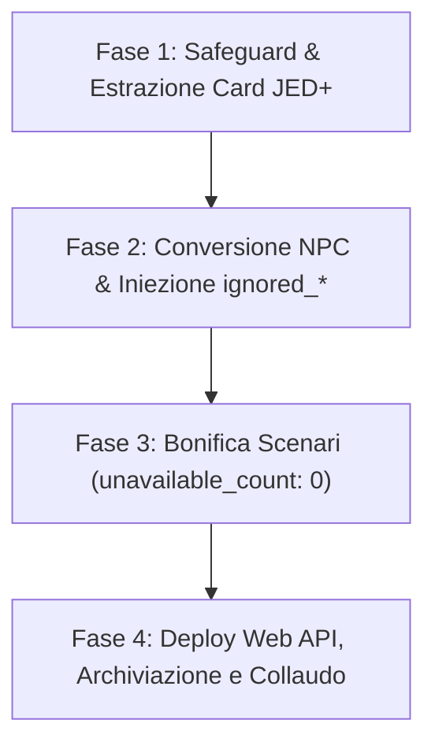

# Wyvern Card & Lorebook Native Suppression Sync

Questa skill codifica e standardizza la pipeline per la conversione di Character Card in NPC nei Lorebook, la bonifica degli scenari multi-character e l'applicazione sistematica della soppressione nativa anti-duplicato di Wyvern (*"Don't Activate When Active"*).

---

## 1. Architettura della Soppressione Nativa Wyvern

### 1.1 Il Problema del Doppio Bot / Persona Collision
Nei Character Scenarios e nelle chat con party/multi-bot su Wyvern, inserire schede NPC complete (>2.000 caratteri) all'interno dei Lorebook con keyword dirette (nome, cognome, alias) causava due classi critiche di anomalie:
1. **Collisione Persona (`{{user}}`):** Se il giocatore seleziona una Persona corrispondente a un NPC presente nel Lorebook (es. Alyssa o Jasper), il motore di injection inserisce comunque la voce del bot, generando risposte spurie o terze persone sdoppiate.
2. **Duplicazione Bot / Ghost Cards:** Se una Character Card esterna è già presente nel party o nella chat stand-alone, l'attivazione contemporanea della voce del Lorebook inietta una seconda istanza ridondante dello stesso personaggio nel context window.

### 1.2 La Soluzione Nativa: `ignored_characters` & `ignored_personas`
L'ispezione reverse-engineering del runtime client di Wyvern (`wv_chunk.js`) ha rivelato che la piattaforma gestisce due array dedicati su ciascuna entry di Lorebook, esposti nel toggle UI **"Don't Activate When Active"** (*"Skip this entry entirely when one of these characters or personas is already in the chat, to avoid a redundant duplicate"*):

```typescript
interface WyvernLorebookEntry {
  entry_id: string;
  name: string;
  type: "npc" | "lore/concept" | "organization/faction" | "memory";
  content: string;
  keys: string[];
  secondary_keys: string[];
  selective: boolean;
  scan_persona: true;           // Tassativamente true
  whole_words_only: true;       // Tassativamente true
  enableEntryHighlighting?: boolean; // Tassativamente true
  ignored_characters: string[]; // ID card personaggio esterne
  ignored_personas: string[];   // ID Persona del giocatore
  custom_avatar_regex?: boolean;
  avatar_activation_regex?: string;
  lines_parsed?: number;
  npc_info?: {
    npc_prefix?: string;
    first_name: string;
    middle_names: string[];
    last_name?: string;
    nicknames: string[];
    titles: string[];
  };
  avatar?: string;              // URL Cloudflare da Gallery del Lorebook
}
```

Quando una delle entità indicate è attiva nella chat corrente, il compiler di Wyvern **salta integralmente l'entry**, garantendo zero duplicazioni nel context window.

> [!IMPORTANT]
> **Superamento dei Workaround Artificiali:** L'adozione di `ignored_characters` e `ignored_personas` abroga tassativamente l'uso di `selective: true` combinato con keyword fittizie ('Dossier', 'Scheda', 'Archivio'). Ogni scheda NPC nel Lorebook può mantenere stabilmente `selective: false`, garantendo piena attivazione naturale in-game quando il bot/persona non è presente.

---

## 2. Pipeline Operativa in 4 Fasi



### Fase 1: Safeguard e Lettura Schede Prima della Dismissione
Prima di eliminare qualsiasi card da `/characters/mine` o archiviarla:
1. Leggere il file JSON locale in `FINAL/<Character>_card.json` o scaricare lo snapshot fresco via `GET /api/characters/:id`.
2. Estrarre la descrizione JED+ completa (accertandosi che superi i 2.000 caratteri e rispetti la formattazione: zero em-dash, dialoghi tra virgolette, azioni in plain text).
3. Estrarre l'URL pubblico dell'avatar e i dati anagrafici per `npc_info`.
4. Salvare uno snapshot preventivo in `scratch/pre_delete_snapshot_<id>.json`.

### Fase 2: Configurazione NPC nel Lorebook con Soppressione Nativa
Nel file del Lorebook (es. `FINAL/Svartulfr_NPC_Primary.json`), aggiornare sia l'array `entries` che l'array `lexicon`:

1. **Campi Obbligatori per Entry NPC Convertita:**
   - `type`: `"npc"`
   - `selective`: `false`
   - `secondary_keys`: `[]`
   - `keys`: array con nome completo, nome proprio, cognome e alias primari
   - `key_logic`: `"AND_ANY"`
   - `avatar`: URL HTTPS valido (Cloudflare imagedelivery o CDN Janitor)
   - `custom_avatar_regex`: `true`
   - `lines_parsed`: `1`
   - `avatar_activation_regex`: multiline regex `(?:^|\n)\s*(?:Nome Completo|Nome|Nickname)\s*:`
   - `npc_info`: `{"first_name": "...", "last_name": "...", "nicknames": [...], "titles": [...]}`
   - `content`: descrizione JED+ narrativa completa
   - `ignored_characters`: `["<ID_della_card_dismessa_o_attiva>"]`
   - `ignored_personas`: `["<ID_della_persona>"]` (se applicabile, es. Alyssa o Jasper)

2. **Configurazione su Card Rimaste Attive:**
   Per tutte le card che rimangono attive in `/characters/mine` (le 8 approvate), censire i loro ID card nell'array `ignored_characters` delle rispettive voci nel Lorebook.

### Fase 3: Configurazione Slot degli Scenari (Solo le 8 Card Esistenti) e Pulizia Macro
Gli scenari multi-character devono includere nell'array `slots` **esclusivamente gli slot corrispondenti alle 8 Character Card realmente esistenti** in `/characters/mine` (`Jasper`, `Mackenzie`, `Erik`, `Malachia`, `Noah`, `Logan`, `Edric`, `Wulfnic`), senza lasciare slot vuoti appartenenti a personaggi convertiti in NPC del Lorebook.

1. **Allineamento Esclusivo degli Slot alle Card Attive:**
   - Configurare l'array `slots` in modo che ogni slot punti con `pool: [{"character_id": "<card_id>", "weight": 100}]` e `unavailable_count: 0` a una delle 8 card esistenti (8 slot in Alyssa Route; 7 slot in Jasper Route dove Jasper è `{{user}}`).
   - Riassegnare tutti i `speaker_slot` dei greeting e dei singoli messaggi (`messages[]`) esclusivamente alle chiavi degli slot delle card esistenti, verificando l'invariante `greeting.speaker_slot == messages[0].speaker_slot` e `greeting.content == messages[0].content`.
2. **Sostituzione Macro e Formattazione NPC nei Greetings:**
   - Cercare tutte le occorrenze di `{{scenarioChar "<slot_key>"}}` nei campi `content` di `greetings` e `messages`.
   - Se `<slot_key>` punta a un NPC del Lorebook, sostituire la macro con il **nome completo letterale** del personaggio e formattare ogni sua battuta su una nuova riga con `Nome Completo: "Dialogo..."` per attivare lo splitting automatico di ritratto e nome.
   - Verificare tassativamente l'invariante: `greeting.speaker_slot == messages[0].speaker_slot` e `greeting.content == messages[0].content`.

### Fase 4: Esecuzione Deploy Web API, Archiviazione e Verifica
1. **Refresh Token e Header HTTP:**
   - Eseguire `python scratch/refresh_token.py` prima delle chiamate.
   - Includere sempre `Authorization: Bearer <token>` e un `User-Agent` personalizzato (es. `AuditorBot/1.0`) per eludere i filtri Cloudflare Error 1010.
2. **Deploy Lorebooks (`PUT /api/lorebooks/:id`):**
   - Inviare payload compatto con i campi `name`, `description`, `visibility`, `rating`, `scan_depth`, `token_budget`, `recursive_scanning`, e `lexicon`. Verificare `HTTP 200`.
   - Sincronizzare la copia locale ottimizzata in `lorebooks/optimized/`.
3. **Deploy Scenari (`PUT /api/character-scenarios/:id`):**
   - Eseguire prima una GET per ricavare l'ultimo `revision`.
   - Inviare payload aggiornato via PUT. Verificare `HTTP 200` e incremento di revisione.
4. **Cancellazione Card Dismesse (`DELETE /api/characters/:id`):**
   - Inviare `DELETE /api/characters/:id`. Verificare `HTTP 204 No Content`.
   - Verificare via `GET /api/characters/mine` che il numero di card corrisponda esattamente a quelle approvate.
5. **Archiviazione Locale:**
   - Spostare i file delle card rimosse in `ARCHIVIO/cards_legacy/`.
   - Spostare i file degli scenari rimossi in `ARCHIVIO/scenarios/`.
   - Verificare che `FINAL/` contenga esclusivamente i file approvati.

---

## 3. Script di Automazione e Test di Regressione

La suite di collaudo deve verificare con asserzioni rigorose tutti i contratti:

```python
# snippet di verifica contratti
mine_res = requests.get('https://app.wyvern.chat/api/characters/mine', headers=headers)
assert len(mine_res.json().get('characters', [])) == 8

scenario_res = requests.get(f'https://app.wyvern.chat/api/character-scenarios/{sid}', headers=headers)
for s in scenario_res.json().get('slots', []):
    assert s.get('unavailable_count', 0) == 0

lorebook_res = requests.get(f'https://app.wyvern.chat/api/lorebooks/{lid}', headers=headers)
for e in lorebook_res.json().get('lexicon', []):
    if e.get('entry_id') == target_eid:
        assert e.get('selective') is False
        assert target_persona_id in e.get('ignored_personas', [])
        assert target_card_id in e.get('ignored_characters', [])
```

---

## 4. Standard Layout JED+ a 4 Blocchi, Gallery Avatar e Copertina Lorebook

1. **Omogeneizzazione Obbligatoria a 4 Blocchi JED+ (`310/310` voci):**
   Ogni entry `npc` dei Lorebook deve contenere nell'ordine:
   - `[NAME: ...; SPECIES: ...; AGE: <età> (Born <Data>); ...]` (blocco iniziale PList tra parentesi quadre, senza macro `{{age}}`, senza date fittizie al 1° del mese).
   - `BACKSTORY: ...`
   - `FAMILY & PACK: ...` (per licantropi/clan dinastici) oppure `CLAN AND COMPANY: ...` (per studenti, docenti, civili, corporativi o sindacati).
   - `VOICE & BEHAVIOR: ...`
   - Sezioni tematiche/RPG di chiusura (`STRENGTHS & WEAKNESSES:`, `INTIMACY & DYNAMICS:`, `RPG STATS & TRAITS:`, ecc.) prive di troncamenti.
2. **Protocollo Gallery & Avatar Placeholder Ufficiale DCC:**
   - Non caricare mai file immagine direttamente dentro la singola entry del Lorebook (causa errori su Wyvern); caricare prima nella **Gallery** del Lorebook (`gallery[]`) e selezionare l'URL pubblico dalla Gallery.
   - Tutte le voci prive di ritratto dedicato devono usare il placeholder ufficiale DCC: `https://imagedelivery.net/Dv4koOwHQU3XnXLqtl0aVQ/99d10d9b-611c-45b7-566a-79c3ed2e9800/public` (`asset/placeholder_npc_avatar.jpg`).
   - Tutti i 6 Lorebook Standalone usano come copertina (`photoURL`) l'emblema della Casata Svartúlfr: `https://imagedelivery.net/Dv4koOwHQU3XnXLqtl0aVQ/1e5124b4-f7d0-46cf-fad9-7ecfc801d100/public` (`asset/emblema_casata_svartulfr.jpg`).
3. **Prevenzione Ricorsione e Asserzioni API:**
   - Impostare `exclude_from_recursion: true` su tutte le entry NPC.
   - Nota API Wyvern: l'endpoint `GET /api/lorebooks/:id` omette la chiave `selective` quando vale `false` (`e.get("selective")` restituisce `None`). Nei test di regressione usare `assert not bool(e.get("selective"))`.

---

## 5. Checklist di Conformità Finale

- [ ] Tutte le card dismesse hanno la scheda JED+ completa salvata nel Lorebook prima della rimozione.
- [ ] Le entry NPC nel Lorebook hanno `type: "npc"`, `selective: false` e metadati avatar/regex validi.
- [ ] Gli ID delle Persona sono in `ignored_personas` e gli ID delle card sono in `ignored_characters`.
- [ ] Tutti gli slot inaccessibili degli scenari hanno `pool: []` e `unavailable_count: 0`.
- [ ] Nessun `speaker_slot` risulta orfano o disallineato rispetto al primo messaggio.
- [ ] Le macro `{{scenarioChar}}` degli NPC sono state sostituite con nomi letterali.
- [ ] Wyvern Web API restituisce HTTP 200/204 su tutti gli endpoint.
- [ ] `CHANGELOG.md` e la documentazione del repository riflettono le modifiche eseguite.

---

## 5. Tooling Automatizzato di Bonifica e Validazione Contratti

La skill include e standardizza due script di produzione:

1. **`scripts/verify_npc_schema_contract.py`**:
   Esegue la verifica automatizzata dei 5 contratti architetturali:
   - *Contract 1:* Validazione rigorosa dello schema `npc_info` (presenza ed integrità di `first_name`, `middle_names`, `last_name`, `nicknames`, `titles`, `npc_prefix`).
   - *Contract 2:* Verifica integrità Gallery del Lorebook (URL Cloudflare HTTPS, assenza di bare scheme o URL rotti).
   - *Contract 3:* Compilazione pesata delle avatar activation regex (simulazione conforme al modulo Wyvern `93312 / WH`).
   - *Contract 4:* Verifica anti-collisione (`ignored_characters`, `ignored_personas`, assenza di umbrella keywords).
   - *Contract 5:* Parità byte-for-byte al 100% tra array `entries` e `lexicon`.

2. **`scripts/remediate_lorebook_npcs.py`**:
   Esegue la bonifica e il deployment dei Lorebook NPC:
   ```bash
   python scripts/remediate_lorebook_npcs.py --apply   # Salva in locale
   python scripts/remediate_lorebook_npcs.py --deploy  # Esegue PUT + GET via Wyvern API
   python scripts/remediate_lorebook_npcs.py --all     # Pipeline completa
   ```

### 6. Riconciliazione Asset Gallery Lorebook (`GET /api/gallery/lorebook/{id}`)
* **Endpoint Ufficiale**: Le immagini registrate nella Gallery del Lorebook risiedono su `GET /api/gallery/lorebook/{lorebook_id}`.
* **Binding URL Diretto**: Assegnare a ciascuna entry l'esatto `imageURL` del corrispondente record di Gallery (es. `erikMain` -> `https://imagedelivery.net/Dv4koOwHQU3XnXLqtl0aVQ/29a667f2-7846-474e-eff4-4dd81d3caf00/public`). Questo elimina l'avviso `Custom Image ⚠️ Unknown source`.
* **Zod Schema Parity**: Mantenere sempre `entries` e `lexicon` identici byte-for-byte in ogni payload di salvataggio per evitare l'errore silenzioso di validazione frontend `entries: Required`.
