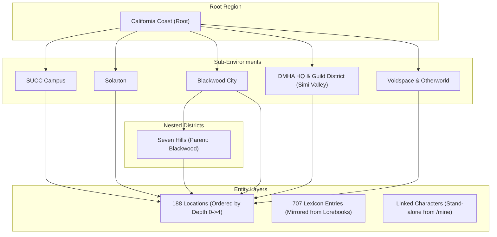

# Wyvern World Deployer

Questa skill codifica e standardizza l'intera pipeline architetturale e operativa per la creazione, manutenzione, deployment e validazione di un **World Leggero su Wyvern** (`app.wyvern.chat`), garantendo perfetta interoperabilità con Character Scenarios, Standalone Lorebooks, Prompt Assemblies e Character Cards.

---

## 1. Architettura del World Leggero

L'architettura del World Leggero su Wyvern separa nettamente le responsabilità tra entità globali e sessioni di gioco, massimizzando il context window utilizzabile e prevenendo sovraccarichi di token.



### 1.1 Principi Fondamentali
1. **Ambiente Contestuale (Stacking):** Wyvern applica un meccanismo di cascading/stacking: il contesto dell'ambiente padre (`California Coast`) fluisce negli ambienti figli (`SUCC`, `Solarton`, `Blackwood`, ecc.), mentre i prompt delle singole Location vengono iniettati solo quando il party si trova fisicamente in quella stanza/area.
2. **Linked Characters da `/mine`:** Il World **non** deve contenere duplicati monolitici delle Character Card (`WorldCharacter`). Al contrario, collega direttamente le Character Card canoniche tramite `linked_character_ids`. In questo modo le card rimangono la Single Source of Truth condivisa tra chat stand-alone, scenari e World.
3. **Lexicon Globale Specchiato:** Tutte le voci enciclopediche (Lore, Fazioni, Concetti, Oggetti DDM, Bacheca Contratti, Memorie) vengono specchiate dai 6 Lorebook Standalone con le flag native standard:
   - `scan_persona: true`
   - `whole_words_only: true`
   - `enableEntryHighlighting: true`
4. **Context Budget Anti-Bloat:**
   - Disattivare le tabelle statistiche ridondanti nel system prompt: `show_party_stats: false`, `show_species_info: false`.
   - Disattivare moduli estranei al canone: `ships: false`, `creature_catcher: false`.
   - Mantenere attivi i moduli interattivi: `inventory: true`, `currency: true`, `combat: true`, `rpg_stats: true`, `relationships: true`.

---

## 2. Invarianti Critici e Bug Trap del Backend Wyvern

### 2.1 Integrità Referenziale `attached_world_character_id: null`
> [!CAUTION]
> **HTTP 500 su Ingestione Lexicon:** Il backend di Wyvern valida le entry del Lexicon con una foreign key strict verso la collezione interna `WorldCharacter`.
> Se una voce di memoria riporta un `attached_world_character_id` che non appartiene al World corrente (ad esempio l'ID di una Character Card stand-alone o un ID legacy), l'API risponde con:
> ```text
> 500: attached_world_character_id must reference a WorldCharacter in the same world
> ```
> **Regola Aurea:** Nei World che utilizzano *Linked Characters* da `/mine`, il campo `attached_world_character_id` deve essere **sempre impostato a `None` / `null`**. L'attivazione contestuale della memoria avviene esclusivamente tramite `keys`, `secondary_keys` e `party_conditions`.

### 2.2 Ordine di Ingestione Topologico delle Location
Il backend di Wyvern richiede che `parent_id` referenzi una Location già esistente. L'ingestione sequenziale arbitraria causa errori `404 Parent Location Not Found`.
- **Procedura Corretta:** Calcolare l'albero delle dipendenze e raggruppare le location per profondità gerarchica (`depth 0` = root, `depth 1` = stanze principali, `depth 2+` = sotto-aree). Inviare i payload rigidamente in ordine crescente di profondità.

### 2.3 Parità Obbligatoria Zod Frontend (`entries == lexicon`)
Il frontend web di Wyvern (`app.wyvern.chat`) utilizza `react-hook-form` con schema Zod che valida la chiave `entries` come array (`entries: z.array(...)`).
Tuttavia, l'endpoint REST `GET /api/worlds/lexicon/world/{id}` restituisce le voci sotto la proprietà `lexicon`.
- **Vincolo:** Ogni script locale o payload di snapshot deve sincronizzare `entries` e `lexicon` per essere byte-for-byte identici, altrimenti il form web fallisce silenziosamente con errore Zod `entries: Required`.

### 2.4 World Clock Gregoriano Prolettico (Epoch 827 d.C.)
Wyvern calcola il tempo assoluto in ore trascorse dall'Epoca `0827-12-21T00:00:00.000Z`.
$$\text{ore} = \frac{\text{Date.parse}(\text{Target ISO}) - \text{Date.UTC}(827, 11, 21)}{3600000}$$
- Esempio di riferimento (26 Agosto 2024, ore 06:00 UTC):
  `world_age: 10489902 Assoluto`.

---

## 3. Workflow Operativo di Deployment

La pipeline si articola in 5 fasi sequenziali:

```text
[1. Estrazione Sorgenti] -> [2. Costruzione Topologia] -> [3. Sanificazione Payload] -> [4. Deploy Batch API] -> [5. Verifica & Snapshot]
```

### Fase 1: Estrazione Sorgenti
Recuperare:
- I 6 Lorebook Standalone (`FINAL/` e `lorebooks/optimized/`).
- Il catalogo delle 188 Location validate (escludendo le entry dismesse del cluster Digitalis).
- La lista degli 8 ID di Character Card stand-alone da collegare.

### Fase 2: Costruzione Topologia
1. Creare o configurare i 7 Environment con le relazioni di parentela esplicite:
   - Root: `California Coast`
   - Figli di California Coast: `SUCC Campus`, `Solarton`, `Blackwood`, `DMHA HQ and Guild District`, `Voidspace & Otherworld`.
   - Figli di Blackwood: `Seven Hills`.
2. Assegnare a ciascuna delle 188 Location l'environment ID di appartenenza.
3. Riconciliare la collocazione di *The Verve* come secret bar retrostante al *Logan's Custom Garage*.

### Fase 3: Sanificazione Payload
1. Forzare `attached_world_character_id: null` su tutte le voci del Lexicon.
2. Assegnare a ogni entry `scan_persona: true` e `whole_words_only: true`.
3. Verificare che non siano presenti keyword ombrello generiche (`solarton`, `vampire`, `werewolf`, ecc.).

### Fase 4: Esecuzione Deploy via API
Eseguire il deploy tramite `scripts/deploy_world.py`:
- Header `User-Agent: Mozilla/5.0` obbligatorio contro Cloudflare 1010.
- Creazione World o resume su ID esistente (`--world-id <id>`).
- Aggiornamento Environments.
- Ingestione Location ordinate per profondità gerarchica.
- Ingestione Lexicon a blocchi (batch size: 50).
- Salvataggio snapshot completo in `scratch/world_new_deployed.json`.

### Fase 5: Verifica e Certificazione
Eseguire `scripts/verify_world.py` per validare:
- 7 Environments corretti e collegati.
- 188 Locations presenti e coerenti (zero orfani).
- 707 Voci di Lexicon attive, con flag corrette e zero collisioni.
- 8 Linked Characters attivi e collegati.
- Ispezione DOM e console con Chrome DevTools.

---

## 4. Helper Scripts Inclusi

La skill include nella directory `scripts/`:
- `deploy_world.py`: Orchestratore batch con gestione retry, rate limiting, resume su ID e WAF bypass.
- `verify_world.py`: Script di collaudo formale che interroga le API e convalida ogni vincolo architetturale.
