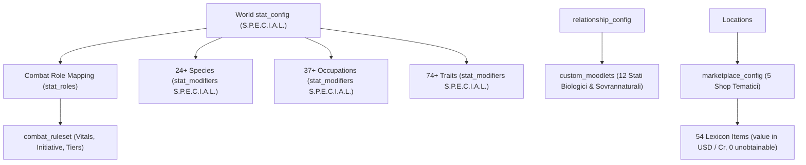

# Wyvern World RPG Automator

Questa skill fornisce una toolchain completa e standardizzata per gestire, riconciliare, manutenere e verificare i **Game/RPG Systems** del modulo World su Wyvern (`app.wyvern.chat`), garantendo l'assoluta conformità con il sistema S.P.E.C.I.A.L., l'integrità del Combat Role Mapping e l'eliminazione di warning su Shop e Reperibilità Oggetti.

---

## 1. Architettura RPG World Wyvern

---

## 2. Componenti Chiave e Standard Operativi

### 2.1 S.P.E.C.I.A.L. Stat Config & Combat Mapping
- **Attributi Ufficiali:** `strength`, `perception`, `endurance`, `charisma`, `intelligence`, `agility`, `luck`.
- **Parametri Base:** `base_value: 8`, `max_value: 30`, `point_budget: 25`.
- **Mapping Obbligatorio `stat_roles`:**
  - `hp_stat`: `"endurance"`
  - `mp_stat`: `"intelligence"`
  - `physical_attack`: `"strength"`
  - `physical_defense`: `"endurance"`
  - `special_attack`: `"intelligence"`
  - `special_defense`: `"intelligence"`
  - `speed`: `"agility"`
  - `accuracy`: `"perception"`
  - `evasion`: `"agility"`
  - `flee`: `"agility"`
  - `luck`: `"luck"`

### 2.2 Auto-Provisioning Engine (Regola 09 §5)
In caso di discrepanza o assenza di Specie, Occupazione o Tratto durante la creazione/modifica di Character Card, User Personas o NPC Lorebook:
- Il sistema invoca `POST https://app.wyvern.chat/api/worlds/rpg/{species|occupations|traits}/{world_id}` con i relativi modificatori S.P.E.C.I.A.L.
- Aggiorna contestualmente i file master in `FINAL/rpg_*_catalog.json` per mantenere l'Omni-Parity.
- **Fastify DELETE Safety (Bug 11.13):** Nei cleanup `DELETE`, omettere tassativamente l'header `Content-Type` per evitare l'eccezione `HTTP 500 FST_ERR_CTP_EMPTY_JSON_BODY`.

### 2.3 Custom Moods Sovrannaturali & Biologici (`custom_moodlets`)
- Il frontend Wyvern richiede rigorosamente la chiave `custom_moodlets` dentro `relationship_config` (mantenendo anche `moodlets` per retrocompatibilità).
- I 12 stati canonici configurati includono: `Rut`, `Heat`, `Scent Marked`, `Mated Devotion`, `Vampiric Blood Hunger`, `Blood Frenzy`, `Essentia Hunger`, `Seductive Haze`, `Pack Bond Resonance`, `Feral Aggression`, `Blood Oath Bond`, `Betrayed Trust`.

### 2.4 Risoluzione Warning Oggetti & `marketplace_config`
- Nessun oggetto deve presentare l'avviso giallo *"items players can never get"*.
- Ciascun item nel World Lexicon (`type: "item"`) deve possedere un prezzo definito in `config.value` (`currency_id` e `amount`).
- Ciascun item deve essere associato ad almeno una Location provvista di `marketplace_config` attivo (`enabled: true`, `inventory: [{ lexicon_entry_id, stock, restock_cycle }]`).

---

## 3. Script di Automazione e Toolchain

La skill si appoggia ai seguenti script collaudati nel repository:
1. `scripts/auto_provision_rpg.py`: Motore dinamico di auto-provisioning con gestione token automatica e sanitizzazione DELETE.
2. `scripts/sync_world_master_snapshots.py`: Sincronizzazione atomica tra live API e storage master locale `FINAL/`.
3. `scripts/test_world_rpg_full_audit.py`: Suite di collaudo con 6 verifiche programmatiche ad asserzione stretta (100% pass).
4. `scripts/validate_world_editor_headless.py`: Validatore browser Playwright Chromium headless per console, rete e DOM dei tab World Editor (`Stats & Species`, `Combat`, `Library 1100`).
